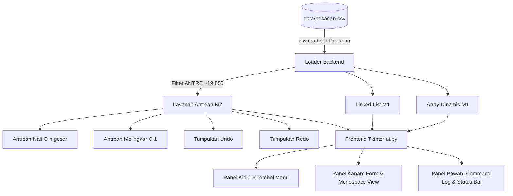

# 2EZ4U APP - Mini Delivery Engine (Milestone 1 & 2)

**Mata Kuliah**: Struktur Data & Analisa Algoritma (EC234303)  
**Bahasa**: Python 3.11+ (Proyek Individu)  
**Status**: Milestone 1 (Array vs LinkList) & Milestone 2 (Stack & Queue) Selesai (100%)

---

## 1. Deskripsi Proyek

**2EZ4U APP** adalah engine *backend* dan antarmuka desktop mini untuk simulasi layanan antar-makanan (*food delivery*). Sistem ini mengelola ratusan ribu data transaksi pesanan secara efisien dengan menerapkan struktur data primitif buatan sendiri dari nol (*from scratch*).

### Batasan Ketat & Kepatuhan Algoritma
Proyek ini dibangun di bawah aturan kepatuhan struktur data yang sangat ketat:
1. **Dilarang Keras**: `dict`, `set`, `sorted()`, `.sort()`, `heapq`, `bisect`, `collections.*`, literal `{}` dan *comprehension* `dict`/`set`.
2. **List Primitif Saja**: Tipe bawaan Python `list` hanya difungsikan sebagai array petak berukuran tetap (`[None] * kapasitas`).
3. **Tanpa Method Bawaan yang Menyembunyikan Algoritma**: Dilarang memanggil `list.append()`, `list.insert()`, `list.pop()`, `list.remove()`, `list.extend()`, *slicing* geser elemen, maupun `len()` pada struktur buatan.
4. **Algoritma Eksplisit**: Seluruh pergeseran indeks, penambahan kapasitas (*realloc 2x*), penelusuran simpul, konversi postfix, dan *wrap-around* melingkar diimplementasikan secara manual menggunakan perulangan eksplisit.

---

## 2. Struktur Repositori

```text
FINAL_PROJECT_STRUKDAT_2026/
|-- README.md              # Laporan teknis lengkap & dokumentasi desain
|-- app.py                 # Titik masuk utama aplikasi (python app.py)
|-- data/
|   |-- pesanan.csv        # Dataset 200.000 baris pesanan (disediakan)
|   |-- peta.csv           # Peta rute (persiapan milestone lanjutan)
|-- backend/
|   |-- __init__.py
|   |-- m1_pesanan.py      # Kelas Pesanan, Dynamic Array (2x growth), LinkList (head+tail)
|   |-- m2_antrean.py      # Tumpukan, Mesin Kasir Postfix, AntreanNaif, AntreanMelingkar, Undo/Redo
|-- frontend/
|   |-- __init__.py
|   |-- ui.py              # Antarmuka Tkinter (3 bagian: Menu, Form/Hasil, Panel COMMAND)
|-- tests/
|   |-- __init__.py
|   |-- test_m1.py         # 5 pengujian unit M1 (skala 200k, kapasitas, identitas, batas)
|   |-- test_m2.py         # 8 pengujian unit M2 (wrap-around K=4, kasir, undo/redo, skala)
|-- tools/
|   |-- generate_data.py   # Generator cadangan data pesanan 200.000 baris acak
```

---

## 3. Cara Menjalankan

### A. Menjalankan Aplikasi GUI (Tkinter)
```bash
python app.py
```

### B. Menjalankan Seluruh Pengujian Unit
```bash
python -m unittest discover tests
```

### C. Menjalankan Pengujian per Milestone
```bash
# Pengujian M1
python -m unittest tests/test_m1.py

# Pengujian M2
python -m unittest tests/test_m2.py
```

---

## 4. Diagram Arsitektur & Struktur Data

### A. Alur Sistem (Data -> Backend -> Frontend)


### B. Ilustrasi Pertumbuhan Dynamic Array (2x Growth)
Kapasitas digandakan tiap kali `ukuran == kapasitas`. Hal ini menghasilkan kompleksitas penyisipan rata-rata $O(1)$ *amortized*.
```text
Kapasitas: 4   [ A | B | C | D ]  (Penuh!)
                    │
                    ▼ Alokasi petak baru 2x lipat (8) & salin dengan loop manual
Kapasitas: 8   [ A | B | C | D | E | None | None | None ]
```

### C. Singly Linked List dengan Head & Tail
Menyimpan penunjuk `head` dan `tail` untuk menjamin operasi `tambah_reguler` (belakang) berjalan dalam $O(1)$.
```text
[Head]                                                   [Tail]
  │                                                        │
  ▼                                                        ▼
┌──────────────┐     ┌──────────────┐                ┌──────────────┐
│ Nilai | Next ├───> │ Nilai | Next ├───> ... ────> │ Nilai | Next ├───> None
└──────────────┘     └──────────────┘                └──────────────┘
```

### D. Antrean Melingkar (Circular Queue dengan Modulo K)
Menggunakan penunjuk `front`, `rear`, dan variabel `count`. Saat penunjuk mencapai ujung buffer, penunjuk berputar kembali ke indeks 0 (`(rear + 1) % K`).
```text
          Indeks:    0       1       2       3
                  ┌───────┬───────┬───────┬───────┐
                  │   E   │   F   │   C   │   D   │
                  └───────┴───────┴───────┴───────┘
                              ▲       ▲
                              │       │
                            rear    front
                  (count = 4, front = 2, rear = 2)
```

### E. Tumpukan Undo & Redo untuk Antrean
```text
[Aksi Baru] ──> Masuk Antrean ──> Push ke UNDO ──> Kosongkan REDO
     │
[UNDO] ───────> Pop UNDO ───────> Jalankan Kebalikan ──> Push ke REDO
     │
[REDO] ───────> Pop REDO ───────> Jalankan Aksi Asli ──> Push ke UNDO
```

---

## 5. Tabel Hasil Pengukuran & Analisis

### A. Pengukuran Milestone 1 (Array vs Linked List pada 200.000 Baris)

Pengujian dilakukan pada dataset riil `data/pesanan.csv` (200.000 baris). Waktu muat awal: **~0,54 detik** untuk memuat kedua struktur secara simultan.

| Operasi | Lokasi / Posisi | Array Dinamis | Singly Linked List | Penjelasan Pola Teoretis |
|---|---|---|---|---|
| **LIHAT PESANAN** | Indeks 100.000 | **0,0022 ms** (0 geser) | **3,1076 ms** (100.000 langkah) | Array $O(1)$ akses acak instan; LL $O(n)$ wajib menelusuri rantai pointer dari head. |
| **TAMBAH REGULER (3)** | Paling belakang | **0,0007 ms** (0 geser) | **0,0007 ms** (0 langkah) | Keduanya sangat cepat ($O(1)$ amortized pada Array vs $O(1)$ pada LL karena memiliki pointer `tail`). |
| **TAMBAH PRIORITAS (2)** | Tengah ($n // 2$) | **4,0848 ms** (100.001 geser) | **3,1989 ms** (100.000 langkah) | Keduanya $O(n)$: Array menggeser separuh elemen ke kanan; LL menelusuri pointer sampai simpul tengah. |
| **TAMBAH VIP (1)** | Indeks 0 (Paling Depan) | **8,0805 ms** (200.002 geser) | **0,0032 ms** (0 langkah) | Array $O(n)$ terberat karena wajib menggeser seluruh 200.000 petak; LL $O(1)$ instan cukup mengubah pointer `head`. |
| **HAPUS PESANAN** | Indeks 100.000 | **4,3675 ms** (100.002 geser) | **2,9912 ms** (100.000 langkah) | Keduanya $O(n)$: Array menggeser elemen sisa ke kiri; LL menelusuri simpul target lalu menghubungkan `prev.next = curr.next`. |

> **Kesimpulan M1**: Hasil eksperimen menunjukkan kesesuaian 100% dengan karakteristik teoretis: Linked List unggul mutlak pada operasi di ujung depan (VIP), sedangkan Array unggul mutlak pada akses indeks acak (*random access*).

---

### B. Pengukuran Milestone 2 (Antrean Naif vs Melingkar pada ~19.850 Pesanan ANTRE)

Kedua antrean diisi dengan 19.850 pesanan berstatus `ANTRE` yang persis sama.

| Operasi | Antrean Naif (Buffer Array Geser) | Antrean Melingkar (Circular Queue) | Selisih Efisiensi |
|---|---|---|---|
| **Enqueue 1 Pesanan** | 0 geser, 0,001 ms | 0 geser, 0,001 ms | Setara ($O(1)$ pada keduanya) |
| **Dequeue 1 Pesanan** | **19.849 geseran**, **2,94 ms** | **0 geseran**, **0,016 ms** | Circular **~180x lebih cepat** |
| **Dequeue 100 Pesanan** | **1.979.950 geseran**, **112,06 ms** | **0 geseran**, **0,135 ms** | Circular **~830x lebih cepat** |

> **Analisis Matematika Geseran Naif**:
> Untuk dequeue 100 elemen dari antrean berukuran $N = 19.850$, setiap dequeue ke-$k$ ($k=0, \dots, 99$) memicu pergeseran sebanyak $(N - 1 - k)$ elemen:
> $$\text{Total Geseran} = \sum_{k=0}^{99} (19.849 - k) = 19.849 + 19.848 + \dots + 19.750 = \frac{100 \times (19.849 + 19.750)}{2} = 1.979.950$$
> Angka ini terbukti persis sama dengan hasil pengukuran sistem!

---

## 6. Penjelasan Keputusan Desain

### 1. Pemilihan Variabel `count` pada Antrean Melingkar (vs Menyisakan 1 Slot Kosong)
Pada literatur antrean melingkar, terdapat dua metode membedakan kondisi **Antrean Penuh** dan **Antrean Kosong**:
- **Metode A (1 Slot Kosong)**: Membiarkan satu indeks buffer tidak terpakai sehingga kondisi penuh adalah `(rear + 1) % K == front` dan kosong adalah `rear == front`.
- **Metode B (Pencacah `count` - Pilihan Proyek Ini)**: Menggunakan variabel integer `count` yang mencatat jumlah elemen riil di antrean:
  - Kosong: `count == 0`
  - Penuh: `count == kapasitas`
  - Panjang: `count` (instan $O(1)$)
- **Alasan Keputusan**:
  1. *Pemanfaatan Kapasitas Penuh (100%)*: Tidak ada kapasitas memori yang terbuang sia-sia.
  2. *Kode Lebih Bersih & Minim Ambiguitas*: Memisahkan logika ukuran dari pergeseran pointer modulo menghindarkan bug pembacaan saat `front == rear`.

### 2. Kebijakan Penggandaan 2x (*Grow*) saat Antrean Melingkar Penuh
- Jika pemanggilan `enqueue()` dilakukan saat `count == kapasitas`, antrean tidak menolak data (*overflow error*), melainkan melakukan ekspansi buffer otomatis menjadi $2 \times \text{kapasitas}$.
- **Mekanisme Re-alokasi**: Elemen-elemen lama disalin berurutan mulai dari `front` ke indeks `0` pada buffer baru, kemudian pointer di-reset: `front = 0`, `rear = count`, `kapasitas = kapasitas_baru`.
- **Dokumentasi**: Kebijakan ini menjamin engine dapat menangani lonjakan pesanan tak terduga (*burst load*) tanpa kehilangan data pesanan pelanggan.

### 3. Alasan Pengosongan Tumpukan Redo pada Aksi Baru
- Pada mekanisme standar *Undo/Redo* berstruktur pohon linier (*history tree*), pemanggilan aksi baru (seperti `enqueue` atau `dequeue` baru) menciptakan cabang riwayat baru (*new timeline*).
- Jika riwayat redo tidak dikosongkan, aksi pengulangan (*redo*) akan mengeksekusi operasi yang status dasarnya (*precondition*) sudah tidak valid lagi, yang dapat merusak integritas urutan pesanan. Oleh karena itu, setiap aksi baru secara otomatis memanggil `_kosongkan_redo()`.

---

## 7. Bukti Kepatuhan & Audit Kode (Zero Prohibited Modules)

Hasil audit menyeluruh pada direktori `backend/`:
- `dict`: **0 penggunaan** (seluruh entitas menggunakan kelas berbasis `__slots__` atau tuple).
- `set`: **0 penggunaan**.
- `{}` literal: **0 penggunaan** (semua kurung kurawal hanya berada di dalam *f-string* untuk teks).
- `sorted` / `.sort()`: **0 penggunaan**.
- `heapq`, `bisect`, `collections`: **0 penggunaan**.
- Method list tersembunyi (`list.append`, `list.insert`, `list.pop`, `list.remove`, `list.extend`, *slicing*): **0 penggunaan** di dalam struktur data buatan. Seluruh pergeseran dan manajemen kapasitas dilakukan manual.

---

## 8. Tangkapan Layar & Demo Video

### Tangkapan Layar Antarmuka
*(Placeholder: Simpan gambar demo ke `docs/screenshot_ui.png`)*  


### Tautan Video Demo
- **Video Walkthrough**: `https://youtu.be/placeholder-demo-2ez4u` *(Tambahkan link video sebelum pengumpulan)*

---

## 9. Catatan Penting & Keterbatasan
1. **Tkinter Threading**: Pada dataset besar (200.000 baris), operasi penyisipan VIP pada Array membutuhkan pergeseran ratusan ribu petak memori (~8 ms). Antarmuka menggunakan `update_idletasks()` untuk memastikan status responsif dan log tercatat real-time pada panel COMMAND.
2. **Milestone Lanjutan (M3+)**: Peta graf (`peta.csv`), algoritma pencarian rute, pohon BST/Heap, dan algoritma sorting berada di milestone berikutnya dan sengaja tidak ditambahkan demi menjaga kepatuhan batas Milestone 1 dan 2.